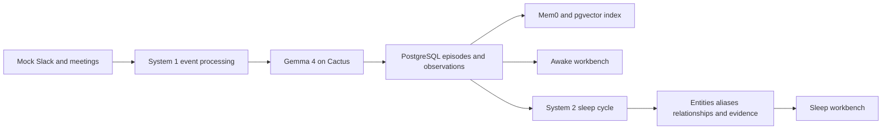

# Synapse

Synapse is a working fast-and-slow memory POC. System 1 replays mocked Slack and meeting
events, interprets each event with a local model, persists the original episode and its
provisional observation, and indexes the episode in Mem0. A user-triggered System 2 sleep
cycle freezes the source episodes and consolidates them into an evidence-backed semantic
graph.

## Current Flow



System 1 currently extracts:

- A compact episode summary
- A short intent label
- Salience from 0 to 1
- Mentioned entities
- Retrieval tags
- Provider confidence and latency

These observations remain provisional. Only System 2 writes canonical entities, aliases,
relationships, and evidence to the semantic graph.

## Implemented Components

### Backend

- FastAPI application with health, configuration, episode-listing, and mock-replay routes
- SQLAlchemy models for source/retrieval episodes, intent observations, and recall events
- Alembic migration that creates the PostgreSQL schema and enables pgvector
- Duplicate-safe ingestion using stable source identifiers
- Pending-memory reconciliation when an episode exists but has not been indexed
- Persisted System 2 runs with frozen episode membership, stages, status, and graph diffs
- Deterministic fixture consolidation into canonical semantic entities and relationships
- Alias resolution connecting `auth database` to the canonical Titan entity
- Idempotent graph upserts and relationship-to-episode evidence links
- Worker container with database connectivity for background-process scaffolding

### Local Inference

- Cactus 2.0.1 running natively on macOS with Apple Metal
- `google/gemma-4-E2B-it` for System 1 structured interpretation
- The same Gemma server for 1,536-dimensional embeddings
- OpenAI-compatible chat, model, and embedding endpoints on port `8080`
- Deterministic interpretation fallback when Cactus is unavailable

### Memory and Storage

- PostgreSQL 18 with pgvector 0.8.5 in Docker
- Mem0 OSS embedded in the FastAPI process
- Mem0 collection `synapse_episodes_gemma_1536`
- Exact Mem0 writes with `infer=False`; Synapse controls the stored summaries
- Mem0 hybrid semantic, keyword, and entity-aware retrieval support
- In-memory Mem0 operation history; durable application state remains in PostgreSQL
- Persistent PostgreSQL Docker volume

### Workbench

- Responsive React 19 and TypeScript interface served by nginx
- Awake/System 1 episode timeline
- PostgreSQL and Cactus status indicators
- Mock replay and refresh controls
- Mem0 indexed/pending state per episode
- Sleep-cycle control and persisted latest-run summary
- Semantic entity browser with aliases, descriptions, kinds, and confidence
- Relationship browser with source/target entities and episode evidence
- Placeholder navigation for Procedural memory; that view has no behavior yet

## Mock Dataset

The deterministic fixture contains five episodes covering:

- The decision to name the authentication database Titan
- Titan and Atlas API migration context across Slack and a meeting
- A project-status request
- A session-backfill blocker
- A proposal to use Crustdata during memory consolidation

Replaying the fixture multiple times does not duplicate episodes. With Cactus running, all
five episodes are indexed in Mem0/pgvector. A sleep cycle currently produces 12 canonical
entities, 7 relationships, the Titan alias, and 8 relationship evidence links. Repeating
the sleep cycle updates the existing graph without duplicating it.

## Run Locally

Prerequisites:

- macOS on Apple Silicon
- Docker Desktop
- Cactus installed with `brew install cactus-compute/cactus/cactus`

Create the local environment file:

```sh
cp .env.example .env
```

Start native Gemma in a separate terminal and leave it running:

```sh
make cactus
```

Start the Docker stack and replay the fixture:

```sh
make up
make replay
```

Open the Sleep view and select **Start sleep cycle**, or trigger it directly:

```sh
curl --fail --request POST http://localhost:3000/api/system2/consolidate
```

Open:

- Workbench: http://localhost:3000
- FastAPI: http://localhost:8000
- OpenAPI: http://localhost:8000/docs

The Docker containers access native Cactus through `host.docker.internal`. If Cactus is not
running, the application remains available in degraded mode and records episodes with
pending Mem0 indexing. Running the replay again after Cactus starts reconciles them.

## API

| Method | Path | Purpose |
| --- | --- | --- |
| `GET` | `/api/health` | PostgreSQL and Cactus availability plus active models |
| `GET` | `/api/config` | Public model, embedding dimension, and retrieval threshold |
| `GET` | `/api/episodes` | Latest persisted episodes and Mem0 indexing state |
| `POST` | `/api/demo/replay` | Idempotently process and reconcile the mock event stream |
| `POST` | `/api/system2/consolidate` | Run a persisted sleep cycle over a frozen episode snapshot |
| `GET` | `/api/system2/runs` | List recent consolidation runs and graph diffs |
| `GET` | `/api/system2/graph` | Return canonical entities, aliases, relationships, and evidence |

## Docker Services

| Service | Current responsibility |
| --- | --- |
| `db` | PostgreSQL 18 and pgvector |
| `migrate` | One-shot Alembic schema upgrade |
| `api` | FastAPI, System 1, Cactus client, and Mem0 |
| `worker` | Background worker process and database heartbeat |
| `web` | nginx-hosted React build and `/api` proxy |
| `test` | Container profile for pytest |

## Commands

```sh
make up       # Build and start the Docker stack
make cactus   # Start native Gemma on Cactus/Metal
make replay   # Process or reconcile the mock event stream
make logs     # Follow API, worker, and web logs
make lint     # Run Python and frontend static checks
make test     # Run backend tests and frontend validation
make down     # Stop containers while preserving PostgreSQL data
make reset    # Stop containers and delete the PostgreSQL volume
```

## Validation Status

The current implementation passes:

- Ruff
- Strict mypy
- Pytest
- ESLint
- TypeScript compilation
- Vite production build
- Alembic migration against PostgreSQL 18
- Docker Compose health checks
- Duplicate replay and pending-memory reconciliation
- Native Gemma chat and embedding smoke tests
- System 2 migration, extraction, alias, evidence, and API schema tests
- Live consolidation and graph idempotency checks

## Current Boundaries

System 2 currently uses a deterministic extractor tailored to the mock dataset; it does not
yet use an LLM extraction pass. The repository does not implement Crustdata API calls,
episodic-to-knowledge-base fallback retrieval, pattern detection, procedural skill
synthesis, or functional MCP tools. The Procedural UI entry remains a placeholder.