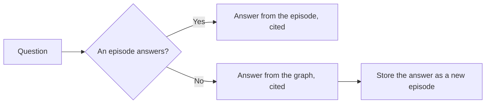

# Synapse

**Cited, time-aware memory for agents, built from workplace conversations.**

[](https://pypi.org/project/synapse-recall/)
[](https://pypi.org/project/synapse-recall/)
[](LICENSE)

Teams rarely lack information; they lose it in thousands of messages. Synapse
reads conversations (Slack threads, meetings) and keeps them as memory an agent
can search and cite: every answer points back to the conversation it came from,
and facts that change are retired instead of piling up.

It is a Python library over SQLite, with no database server to run, and talks
to any OpenAI-compatible chat and embedding endpoints.

## Features

- **Episodic memory.** Each conversation is stored whole, labelled by a model
  (intent, salience, summary, entities, tags) and chunked into vectors, so any
  part of a long thread can be found.
- **Hybrid search.** Vector search over the chunks, plus SQLite full-text
  search for exact terms like error strings and config keys.
- **A knowledge graph with evidence.** Consolidation turns conversations into
  entities and relationships, and each relationship keeps the conversation that
  asserted it.
- **Facts that expire.** When a task is reassigned or a service changes hands,
  the old fact is closed, not deleted: the graph answers with what is true now
  and can still say what used to be.
- **Episodic-first recall.** Recall answers from conversations first, falls
  back to the graph, and stores a successful fallback so the next similar
  question is answered directly.
- **Reviewed procedures.** Recall workflows that keep succeeding become skill
  candidates, which a person approves before any agent can use them.
- **Isolated groups.** All memory is scoped to a `group_id` (a customer, a
  team), and no query crosses groups.
- **Bring your own models.** Any OpenAI-compatible chat and embedding
  endpoints, hosted or local, reasoning or not.

## Installation

```bash
pip install synapse-recall
```

Requires Python 3.12+. The package is `synapse-recall` on PyPI (the shorter
names were taken) and is imported as `synapse`.

## Quickstart

Store a conversation, then ask about it:

```python
import asyncio
from datetime import UTC, datetime

from sqlalchemy.ext.asyncio import async_sessionmaker, create_async_engine

from synapse.config import Settings
from synapse.db import models  # noqa: F401  registers the tables
from synapse.db.base import Base
from synapse.db.models import SourceType
from synapse.db.pragmas import configure_sqlite
from synapse.domain.models import SourceEvent
from synapse.episodic.service import SystemOneService
from synapse.inference.chat import LLMInterpreter
from synapse.memory.mem0_store import Mem0EpisodeStore
from synapse.recall.service import RecallService

settings = Settings(
    database_url="sqlite+aiosqlite:///memory.db",
    chat_base_url="https://inference.example.com/v1",
    chat_model="your-chat-model",
    chat_api_key="...",
    embedding_base_url="https://embeddings.example.com/v1",
    embedding_model="your-embedding-model",
    embedding_api_key="...",
    embedding_dimensions=1024,
)


async def main() -> None:
    engine = create_async_engine(settings.database_url)
    configure_sqlite(engine)  # WAL, a busy timeout, foreign keys
    async with engine.begin() as conn:
        await conn.run_sync(Base.metadata.create_all)
    sessions = async_sessionmaker(engine, expire_on_commit=False)

    index = Mem0EpisodeStore(settings)
    system_one = SystemOneService(LLMInterpreter(settings), index)
    recall = RecallService(memory_store=index, settings=settings)

    thread = SourceEvent(
        source_id="slack-C123-1731400000.000100",
        source_type=SourceType.SLACK,
        conversation_id="C123-1731400000.000100",
        content=(
            "Priya: Who owns the checkout service now?\n"
            "Sam: I handed it to Priya last week; she's on call for it."
        ),
        participants=["Priya", "Sam"],
        occurred_at=datetime.now(UTC),
    )

    async with sessions() as session:
        episode, created = await system_one.process(thread, "acme", session)
        result = await recall.recall("Who owns checkout?", "acme", session)

    print(result.answer_origin, result.answer)
    for citation in result.citations:
        print("  cited:", citation)


asyncio.run(main())
```

`process` is idempotent on `source_id`: storing the same conversation again
costs nothing, and a longer version of it (a thread that got replies) replaces
the stored one and its vectors. Build the graph from stored episodes with
`ConsolidationService(settings=settings).run("acme", session)`.

## How it works

Synapse separates memory into three layers, after *Thinking, Fast and Slow*.

### Episodes (System 1)

Every incoming conversation becomes an episode: its full text, one model call's
reading of it (intent, salience from 0 to 1, a summary, mentioned entities,
tags), and its vectors. If the labelling call fails, a rule-based label is used
so the conversation is still stored. These labels are provisional; only the
graph holds canonical entities.

### The semantic graph (System 2)

A consolidation run reads a snapshot of episodes and merges what they assert
into entities and relationships. The merge is deterministic; a model only
decides whether two names are the same thing. Every relationship cites its
episode.

Relationships hold over a period. Each gets `valid_at` from the conversation
that asserted it, and `invalid_at` stays empty while it is current. Predicates
that admit one answer at a time, like a task's assignee or a service's owner,
close the previous edge when a new one is asserted; predicates that accumulate
(`mentions`, `depends_on`, `blocks`) never close that way. Order comes from the
conversations, not import order, so importing an old export cannot retire a
newer fact. Reads return current edges by default.

### Recall



Recall searches episodes and asks the chat model whether the best match
actually answers the question. If none does, it answers from the graph and
writes that answer back as an episode, so memory learns from its own lookups.

### Procedures

Recall patterns that repeat and succeed become versioned skill candidates. They
stay private until a person approves one; only approved skills are offered to
agents.

## Configuration

Settings are read from the environment (or a `.env` file), or passed to
`Settings(...)` directly. Every service takes a `Settings`.

| Setting | Default | Purpose |
| --- | --- | --- |
| `DATABASE_URL` | `sqlite+aiosqlite:///./synapse.db` | The database; the vector index is a second file next to it |
| `CHAT_BASE_URL` | `http://localhost:8080/v1` | The chat endpoint |
| `CHAT_MODEL`, `CHAT_API_KEY` | none | The chat model, for labelling, graph extraction, answerability and alias checks |
| `CHAT_REASONING_TOKENS` | `0` | Extra completion budget for a model that thinks before answering |
| `CHAT_CLASSIFY_TIMEOUT` | `8` | Seconds to wait for one conversation's label |
| `EMBEDDING_BASE_URL` | `http://localhost:8080/v1` | The embedding endpoint |
| `EMBEDDING_MODEL`, `EMBEDDING_API_KEY` | none | The embedding model, for the vector index |
| `EMBEDDING_DIMENSIONS` | `1536` | Must match the embedding model |
| `MEM0_COLLECTION` | `synapse_episodes` | The index's collection name; one per embedding model |
| `MEMORY_HIT_THRESHOLD` | `0.62` | How close an episode must be to answer from it |
| `INFERENCE_MODE` | `auto` | `fake` gives deterministic labels with no model, for tests |
| `CRUSTDATA_API_KEY` | none | Optional company enrichment during consolidation |

**Reasoning models.** Each call asks only for the tokens its answer needs (48
for a label). A reasoning model spends its thinking from the same budget and
can run out before answering, so set `CHAT_REASONING_TOKENS` to a few thousand
for one; it costs nothing on a model that doesn't reason. Such models can also
take longer than 8 seconds on a long conversation, so raise
`CHAT_CLASSIFY_TIMEOUT` too.

**Changing the embedding model** invalidates the index, since vectors from two
models can't be compared. Use a new `MEM0_COLLECTION` and re-index.

## Server, MCP and workbench

The repository also runs Synapse as a service with Docker Compose: a FastAPI
server, an MCP server for coding agents, and a web workbench to browse
episodes, the graph and skill candidates.

```bash
cp .env.example .env   # then point CHAT_* and EMBEDDING_* at your endpoints
make up                # API on :8000, workbench on :3000
```

Load a Slack export (it is read through a read-only mount and never copied
into the repo; bots, system events, emails, phone numbers and secret-like
tokens are dropped), or the bundled sample events:

```bash
export SLACK_EXPORT_DIR=/absolute/path/to/export SYNAPSE_GROUP_ID=acme
make slack-preview   # aggregate counts only
make slack-import

SYNAPSE_GROUP_ID=demo make replay   # or the sample events
```

| Method | Path | Purpose |
| --- | --- | --- |
| `POST` | `/api/recall` | Recall, with citations |
| `GET` | `/api/episodes` | Latest episodes and their index state |
| `POST` | `/api/system2/consolidate` | Run a consolidation |
| `GET` | `/api/system2/graph` | Entities, relationships and evidence |
| `GET` | `/api/system2/runs` | Recent consolidations and what they changed |
| `POST` | `/api/procedural/detect` | Find repeated recall workflows |
| `GET` | `/api/procedural/skills` | Skill candidates and their review state |
| `POST` | `/api/procedural/skills/{id}/status` | Approve or reject a skill |
| `GET` | `/api/health` | Database and model availability |

Every memory route takes `group_id` as a query parameter. Full schema at
`http://localhost:8000/docs`.

The MCP server (`docker compose run --rm -T --build mcp`, registered in
`.vscode/mcp.json`) exposes `recall`, `get_episode`, `list_skill_specs` and
`get_skill_spec`, each taking `group_id`.

## Development

```bash
uv sync
uv run pytest
uv run ruff check src tests
uv run mypy src
```

`make test` and `make lint` run the same checks, plus the workbench's, in
Docker.

Upgrading a database from before groups existed: migration `0005` assigns
every existing row to `SYNAPSE_BACKFILL_GROUP_ID` (default `default`); set it
before `alembic upgrade head`.

## License

MIT
