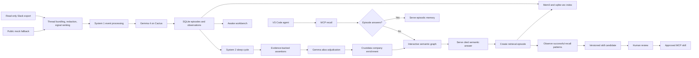

# Synapse

**A local-first cognitive memory layer that turns scattered workplace conversations into
episodic memories, evidence-backed knowledge graphs, and reusable agent workflows.**

## Install

```bash
pip install synapse-recall
```

The distribution is `synapse-recall` because `synapse` and `synapse-memory` were already
taken on PyPI by unrelated projects; the import is `synapse`. Embedding it in another
application needs nothing but two OpenAI-compatible endpoints — memory is a pair of
SQLite files (`memory.db` and its `memory.vectors.db` index), with no database server
to run — see [Using a Different Model Server](#using-a-different-model-server).

To run the whole thing instead, including the API and the workbench, clone the repo and
use Compose as described under [Run Locally](#run-locally).

## Demo Video

[Watch the Synapse demo on Loom](https://www.loom.com/share/219bf4ea14e849dd81a5ed1c45c57000)

Teams do not lose context because information is absent; they lose it because decisions,
owners, blockers, and rationale are buried across thousands of messages. Search returns more
messages. Synapse builds memory.

Inspired by *Thinking, Fast and Slow*, Synapse separates organizational cognition into three
phases:

1. **Awake / System 1:** capture high-signal conversations, classify them locally, and index
	 them as durable episodes.
2. **Sleep / System 2:** consolidate episodes into an inspectable semantic graph where every
	 relationship cites its source conversation.
3. **Procedural memory:** observe repeated successful recall workflows and propose versioned
	 skills that require human approval before agents can use them.

## Why It Is Different

- **Episodic-first retrieval:** search lived conversations before consulting derived knowledge.
- **Memory that learns from retrieval:** a successful graph fallback is written back as a new
	episode, making similar future questions faster and more direct.
- **Evidence over confident summaries:** every semantic edge retains the Slack conversation
	that supports it.
- **Facts that expire instead of piling up:** when a task is reassigned or a service changes
	hands, the old edge is closed rather than deleted, so the graph answers with what is true
	now and can still say what used to be.
- **Local inference by default, not by assumption:** Gemma runs through Cactus on Apple Metal,
	so raw conversations are not sent to a hosted LLM. Nothing below the settings knows that —
	inference is two OpenAI-compatible endpoints, and pointing them elsewhere is configuration.
- **Human-reviewed procedures:** repeated behavior can become an MCP skill, but misses never do
	and candidates remain private until approved.
- **Agent boundary:** Synapse supplies context and procedure; VS Code/Copilot owns code edits,
	commands, and tests.

## Demo Snapshot

The prepared local demo currently contains:

| Signal | Verified state |
| --- | ---: |
| Real Slack conversations | 40 thread-bundled episodes |
| Mem0 indexing | 40 / 40 indexed |
| Semantic graph | 43 entities, 40 relationships |
| Evidence coverage | 40 / 40 relationships cited |
| Inference failures | 0 observation, 0 assertion failures |

The private Slack export is never committed. It is mounted read-only for a one-shot import;
emails, phone numbers, secret-like tokens, bots, deleted users, and system events are filtered
before ingestion.

## Sponsor Technology

- **Cactus:** runs `google/gemma-4-E2B-it` locally for System 1 classification, compact semantic
	assertions, answerability checks, alias adjudication, and 1,536-dimensional embeddings.
- **Crustdata:** enriches resolved company nodes during System 2 only; coverage misses remain
	unknown instead of being filled with fixture data.
- **Mem0:** provides the episodic vector-memory layer, over SQLite and sqlite-vec through
	a provider Synapse implements.

The product also demonstrates how approved Synapse procedures can guide coding agents through
MCP without giving the memory server code-execution authority.

## Architecture



System 1 currently produces:

- A Gemma-classified intent label
- Gemma-classified salience from 0 to 1
- An event-local compact summary assembled without cross-event inference
- Explicit entity mentions supplied by validated source assertions
- Source and intent retrieval tags
- Provider and latency metadata

These observations remain provisional. Only System 2 writes canonical entities, aliases,
relationships, and evidence to the semantic graph.

## When Facts Change

A relationship holds over a period rather than forever. Consolidation stamps every edge with
`valid_at`, taken from the conversation that asserted it, and leaves `invalid_at` empty while
the fact is current.

Some predicates only admit one answer at a time. A task has one assignee, and a service has one
owner, so asserting a new one closes the previous edge by setting `invalid_at` to the moment the
replacement was asserted. Predicates that legitimately accumulate — `mentions`, `depends_on`,
`blocks` — are never closed this way, and closure is directional: `owns` retires the previous
owner of a thing without stopping a person from owning several things.

Ordering comes from the conversation, not from import order, so importing an old Slack export
after a recent one cannot retire the newer fact. An edge asserted again after being closed
reopens rather than duplicating.

Graph reads return current edges by default. Closed edges are kept, not deleted, so history
stays queryable, and each consolidation run reports how many edges it retired.

## What We Built

- **Awake workbench:** a chronological episode stream with local-model intent, salience,
	participants, source metadata, and Mem0 indexing state.
- **Sleep workbench:** an interactive React Flow graph with deterministic Dagre layout, type
	filters, minimap, zoom controls, relationship evidence, and external enrichment provenance.
- **Episodic-first recall:** typed HTTP and MCP tools that answer from episodes, use semantic
	fallback only when required, preserve citations, and learn from successful fallback.
- **Procedural workbench:** repeated successful recall patterns become immutable, versioned
	skill candidates with approve/reject controls and approved-only MCP exposure.

## Stack

| Layer | Technology |
| --- | --- |
| Inference | Any OpenAI-compatible endpoint; Cactus, Gemma 4 E2B, Apple Metal by default |
| Episodic memory | Mem0 OSS |
| Durable storage | SQLite, sqlite-vec, FTS5, SQLAlchemy, Alembic |
| API and agents | FastAPI, MCP Python SDK v1 |
| Workbench | React 19, TypeScript, React Flow, Dagre, Vite |
| Runtime | Docker Compose; native Cactus is the Metal-accelerated exception |

## Source Data

### Local Slack Export

The preferred demo source is a locally extracted Slack export. The importer reads the
export through a temporary read-only Docker mount and does not copy users, messages,
attachments, avatars, emails, or phone fields into the repository. It:

- Resolves human user IDs to display names while excluding bots, deleted users, and system events
- Bundles a root message and its replies into one episodic conversation
- Redacts emails, phone numbers, secret-like tokens, and raw link targets
- Scores decisions, blockers, actions, deadlines, status updates, threads, reactions, and files
- Balances selected conversations across channels instead of letting the largest channel dominate
- Uses compact local Gemma calls for System 1 classification and one evidence-backed graph assertion

Preview aggregate selection statistics without storing or printing message content:

```sh
export SLACK_EXPORT_DIR="/absolute/path/to/extracted-slack-export"
make slack-preview
```

The default preview selects up to 40 conversations with a score of at least 4, capped at
30 per channel from `all-docwise` and `scribe-iteration`. Import the same deterministic set:

```sh
export SYNAPSE_GROUP_ID="acme"
make slack-import
curl --fail --request POST "http://localhost:3000/api/system2/consolidate?group_id=acme"
```

One export belongs to one account, so `SYNAPSE_GROUP_ID` names where it lands. Importing a
second workspace under a different `group_id` keeps the two entirely separate, including
channels that happen to share a name.

Re-running the import is idempotent because source IDs derive from channel and Slack thread
timestamps. Keep the export outside this repository; `slack-exports/` is ignored as an
additional guard if a local copy is ever created.

### Mock Fallback

The deterministic fixture contains 18 chronological Slack and meeting episodes covering:

- Officially sourced product context for Channel3, Allus AI, Random Labs, and Hexclave
- Internal evaluation decisions that adopt, defer, or limit each possible integration
- The boundary between Synapse memory guidance and Random Labs repository execution
- Hexclave as a future identity candidate for a multi-user Synapse
- A non-critical Channel3 API-access blocker and the decision not to fake an integration
- Repeated status requests with explicit owners, deadlines, blockers, and next actions
- Recall rehearsal and final demo-readiness approval

Public product claims include an official source URL in event metadata. Internal fit,
ownership, blocker, and scope statements are clearly framed as mock team decisions. The
source adapter also supplies generic validated semantic assertions; extraction code has no
knowledge of sponsor names. Crustdata is called only from System 2 after a `Company` entity
and domain have been resolved. It is an enrichment provider, not a source-memory company.

Replaying the fixture multiple times does not duplicate episodes. With Cactus running, all
18 episodes are indexed in Mem0/sqlite-vec. A sleep cycle currently produces 21 canonical
entities and 20 relationships. Repeating the sleep cycle updates the existing graph without
duplicating it. With `CRUSTDATA_API_KEY` configured, Crustdata attempts live enrichment for
the four sponsor company nodes; provider coverage is preserved as an observed result rather
than filled with invented data.

## Run Locally

Prerequisites:

- macOS on Apple Silicon
- Docker Desktop
- Cactus installed with `brew install cactus-compute/cactus/cactus`

Create the local environment file:

```sh
cp .env.example .env
```

Start native Gemma in a separate terminal and leave it running:

```sh
make cactus
```

Start the Docker stack:

```sh
make up
```

Then choose one source path.

For a local Slack export:

```sh
export SLACK_EXPORT_DIR="/absolute/path/to/extracted-slack-export"
make slack-preview
make slack-import
```

For the public deterministic fallback:

```sh
export SYNAPSE_GROUP_ID="demo"
make replay
```

Open the Sleep view and select **Start sleep cycle**, or trigger it directly:

```sh
curl --fail --request POST "http://localhost:3000/api/system2/consolidate?group_id=demo"
```

Ask Synapse through HTTP. This example is available with the public fallback dataset:

```sh
curl --fail "http://localhost:3000/api/recall?group_id=demo" \
	--header 'Content-Type: application/json' \
	--data '{"query":"What does Random Labs build and how does it complement Synapse?"}'
```

### Use MCP in VS Code

VS Code discovers the `synapse-recall` server from `.vscode/mcp.json`. The configuration
launches the current server image with:

```sh
docker compose run --rm -T --build mcp
```

Keep native Cactus and the Docker stack running, then:

1. Open the Command Palette with `Cmd+Shift+P`.
2. Run **MCP: List Servers**.
3. Select `synapse-recall` and start or restart it.
4. Open Copilot Chat in Agent mode.
5. Enable the Synapse tools in the tools picker if they are not already enabled.

Available tools:

- `recall(query)` runs the episodic-first learning loop and returns structured citations.
- `get_episode(episode_id)` inspects one durable episode cited by a recall result.
- `list_skill_specs()` lists approved procedural workflows.
- `get_skill_spec(name)` returns one approved workflow with steps and guardrails.

With the public fallback dataset, example agent prompts are:

```text
Use the synapse-recall recall tool to compare the team decisions about Random Labs,
Hexclave, Channel3, and Allus AI. Include the evidence citations.
```

```text
Ask Synapse why the Channel3 integration was limited to public product context.
```

With a private Slack import, use a person, task, product, or decision visible in the Awake
timeline so the recording does not disclose unrelated workspace context.

For an answer already present in an episode, `answer_origin` is `episodic`. When episodes
do not contain the answer, it is `semantic_fallback` and `created_episode_id` identifies the
new retrieval episode. A similar later request should return `episodic` with
`memory_kind: retrieval` in `score_details`.

After changing MCP code, use **MCP: List Servers → synapse-recall → Restart Server**. If
the server is not listed, run **Developer: Reload Window**. Running the Compose MCP command
manually will appear idle because the process is waiting for protocol messages on stdin.

### Build Procedural Memory

Repeat a recall workflow at least twice, then use the Procedural view's **Detect patterns**
button or call:

```sh
curl --fail --request POST "http://localhost:3000/api/procedural/detect?group_id=demo"
```

Review the generated skill in the Procedural view. Candidate and rejected skills remain
private to the workbench; approving a skill makes it visible to `list_skill_specs` and
`get_skill_spec` after the MCP server is restarted.

Open:

- Workbench: http://localhost:3000
- FastAPI: http://localhost:8000
- OpenAPI: http://localhost:8000/docs

The Docker containers access native Cactus through `host.docker.internal`. If Cactus is not
running, health reports degraded and `INFERENCE_MODE=auto` refuses to store a fallback
System 1 observation. Use `INFERENCE_MODE=fake` only when deterministic interpretation is
explicitly desired.

## Using a Different Model Server

Inference is addressed as two OpenAI-compatible endpoints rather than as a named provider.
Chat and embeddings are configured apart because they are not always the same service — a
gateway that serves chat may serve no embedding model at all.

| Setting | What it addresses |
| --- | --- |
| `CHAT_BASE_URL`, `CHAT_MODEL`, `CHAT_API_KEY` | Classification, assertion extraction, answerability, alias adjudication |
| `CHAT_REASONING_TOKENS` | Extra completion budget, for a model that thinks before it answers |
| `EMBEDDING_BASE_URL`, `EMBEDDING_MODEL`, `EMBEDDING_API_KEY`, `EMBEDDING_DIMENSIONS` | The Mem0 episode index |

The defaults are a local Cactus for both, which ignores the key, so `cactus-local` stands in
for one. A hosted endpoint checks it.

Embedded in another application, the same values can be passed at construction instead of
read from the environment. Every service takes a `Settings`, and passes it to whatever it
builds:

```python
settings = Settings(
    chat_base_url="https://inference.example.com/v1",
    chat_model="openai/gpt-oss-120b",
    chat_api_key=key,
    chat_reasoning_tokens=2048,
    embedding_base_url="https://embeddings.example.com/v1",
    embedding_dimensions=1024,
    embedding_api_key=key,
)
system_one = SystemOneService(LLMInterpreter(settings), Mem0EpisodeStore(settings))
recall = RecallService(settings=settings)
```

### Reasoning models need more room

Each call asks for as many tokens as its answer needs — 48 for a classification, 140 for an
assertion — because that is the whole cost on a model that answers directly. A reasoning
model bills its private thinking against the same budget and can spend all of it before
writing a character, and the failure is quiet: the request succeeds, `finish_reason` is
`length`, and `content` is `null`.

`CHAT_REASONING_TOKENS` is added to every call's budget, leaving the per-call sizes alone. A
few thousand is a reasonable starting point. It costs nothing on a model that doesn't reason,
which stops when it is done rather than when it hits the cap. Leave it out and the first call
raises an `InferenceError` that names it.

Changing `EMBEDDING_MODEL` or `EMBEDDING_DIMENSIONS` invalidates an existing index — vectors
from two models are not comparable — so give the new one its own `MEM0_COLLECTION` and
re-index rather than mixing them.

## API

Every route that touches stored memory requires a `group_id` query parameter naming
the account to read from or write to. Memory is never shared between accounts: an
entity, a workflow, or a Slack thread with the same name in two accounts is two
separate rows, and no query returns another account's data. `group_id` is any stable
label you choose — a customer slug, a team name — and it has no default, so a request
that omits it is rejected rather than silently landing somewhere.

Upgrading an existing database: migration `0005` assigns every pre-existing row to a
single account, named by `SYNAPSE_BACKFILL_GROUP_ID` and defaulting to `default`. Set it
before running `alembic upgrade head` to pick the name; changing it afterwards is a plain
`UPDATE`, since the value is only a label.

| Method | Path | Purpose |
| --- | --- | --- |
| `GET` | `/api/health` | Database and model-server availability plus active models |
| `GET` | `/api/config` | Public model, embedding dimension, and retrieval threshold |
| `GET` | `/api/episodes?group_id=` | Latest persisted episodes and Mem0 indexing state |
| `POST` | `/api/demo/replay?group_id=` | Idempotently process and reconcile the mock event stream |
| `POST` | `/api/recall?group_id=` | Search episodes first, fall back to graph, and learn from fallback |
| `POST` | `/api/procedural/detect?group_id=` | Detect repeated recall workflows and synthesize skills |
| `GET` | `/api/procedural/patterns?group_id=` | List observed workflow patterns and evidence IDs |
| `GET` | `/api/procedural/skills?group_id=` | List skill candidates, versions, and review states |
| `POST` | `/api/procedural/skills/{id}/status?group_id=` | Approve, reject, or reset a skill candidate |
| `POST` | `/api/system2/consolidate?group_id=` | Run a persisted sleep cycle over a frozen episode snapshot |
| `GET` | `/api/system2/runs?group_id=` | List recent consolidation runs and graph diffs |
| `GET` | `/api/system2/graph?group_id=` | Return canonical entities, aliases, relationships, and evidence |

The MCP tools take `group_id` the same way: `recall`, `get_episode`,
`list_skill_specs`, and `get_skill_spec` each require it as an argument.

## Docker Services

| Service | Current responsibility |
| --- | --- |
| `migrate` | One-shot Alembic schema upgrade |
| `api` | FastAPI, System 1, the chat client, and Mem0 |
| `worker` | Background worker process and database heartbeat |
| `web` | nginx-hosted React build and `/api` proxy |
| `mcp` | On-demand stdio MCP server for VS Code |
| `test` | Container profile for pytest |

## Commands

```sh
make up             # Build and start the Docker stack
make cactus         # Start native Gemma on Cactus/Metal
make slack-preview  # Preview aggregate real-export selection metadata
make slack-import   # Import selected local Slack conversations
make replay         # Process the public mock fallback
make logs           # Follow API, worker, and web logs
make lint           # Run Python and frontend static checks
make test           # Run backend tests and frontend validation
make down           # Stop containers while preserving the SQLite volume
make reset          # Stop containers and delete the SQLite volume
```

## Verified

The current implementation passes:

- 21 backend tests
- Ruff
- Strict mypy
- Pytest
- ESLint
- TypeScript compilation
- Vite production build
- Alembic migration against SQLite
- Docker Compose health checks
- A live 40-conversation import with zero observation or assertion failures
- A live 43-entity, 40-relationship graph with evidence on every edge
- Duplicate replay and pending-memory reconciliation
- Slack thread grouping, bot exclusion, redaction, ranking, and channel balancing
- Native Gemma chat and embedding smoke tests
- System 2 migration, extraction, alias, evidence, and API schema tests
- Gemma alias-adjudication and fallback tests
- Crustdata no-key behavior and live-response parser tests
- Live consolidation and graph idempotency checks
- Live Crustdata enrichment and cache verification
- Episodic miss → semantic fallback → retrieval-episode write-back
- Paraphrased episodic hit with preserved original citations
- MCP initialize, tool discovery, and structured `recall` invocation over stdio
- Idempotent pattern detection and immutable skill revision checks
- Candidate approval synchronization between patterns and skills
- Approved-only procedural skill discovery through MCP

## Honest Boundaries

System 2 deterministically merges validated semantic assertions emitted by source adapters,
then uses Gemma to adjudicate ambiguous aliases. Assertions use generic entity and
relationship schemas; runtime extraction and inference contain no fixture-specific names.
The installed E2B model is not used to generate the complete nested graph because its long
structured output is unreliable. The current procedural templates cover company research,
architecture context, and project status briefing families. Pattern classification and
synthesis are deterministic and transparent rather than LLM-generated. Synapse exposes
approved guidance only; coding actions remain with the VS Code agent. The Slack importer
selects a balanced high-signal subset rather than claiming that every workspace message is
memory-worthy, and Crustdata enriches only company nodes it can identify confidently.