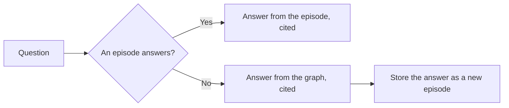

# Synapse

**Cited, time-aware memory for agents, built from workplace conversations.**

[](https://pypi.org/project/synapse-recall/)
[](https://pypi.org/project/synapse-recall/)
[](LICENSE)

Teams rarely lack information; they lose it in thousands of messages. Synapse
reads conversations (Slack threads, meetings, chats, calls) and keeps them as memory an agent
can search and cite: every answer points back to the conversation it came from,
and facts that change are retired instead of piling up.

It is a Python library over SQLite, with no database server to run, and talks
to any OpenAI-compatible chat and embedding endpoints.

## Features

- **Episodic memory.** Each conversation is stored whole, labelled by a model
  (intent, salience, summary, entities, tags) and chunked into vectors, so any
  part of a long thread can be found.
- **Hybrid search.** Vector search over the chunks, plus SQLite full-text
  search for exact terms like error strings and config keys.
- **A knowledge graph with evidence.** Consolidation turns conversations into
  entities and relationships, and each relationship keeps the conversation that
  asserted it.
- **Facts that expire.** When a task is reassigned or a service changes hands,
  the old fact is closed, not deleted: the graph answers with what is true now
  and can still say what used to be.
- **Episodic-first recall.** Recall answers from conversations first, falls
  back to the graph, and stores a successful fallback so the next similar
  question is answered directly.
- **Reviewed procedures.** Recall workflows that keep succeeding become skill
  candidates, which a person approves before any agent can use them.
- **Isolated groups.** All memory is scoped to a `group_id` (a customer, a
  team), and no query crosses groups.
- **Bring your own models.** Any OpenAI-compatible chat and embedding
  endpoints, hosted or local, reasoning or not.

## Installation

```bash
pip install synapse-recall
```

Requires Python 3.12+. The package is `synapse-recall` on PyPI (the shorter
names were taken) and is imported as `synapse`.

## Quickstart

Store a conversation, then ask about it:

```python
import asyncio
from datetime import UTC, datetime

from sqlalchemy.ext.asyncio import async_sessionmaker, create_async_engine

from synapse.config import Settings
from synapse.db.schema import create_schema
from synapse.db.models import SourceType
from synapse.db.pragmas import configure_sqlite
from synapse.domain.models import SourceEvent
from synapse.episodic.service import SystemOneService
from synapse.inference.chat import LLMInterpreter
from synapse.memory.mem0_store import Mem0EpisodeStore
from synapse.recall.service import RecallService

settings = Settings(
    database_url="sqlite+aiosqlite:///memory.db",
    chat_base_url="https://inference.example.com/v1",
    chat_model="your-chat-model",
    chat_api_key="...",
    embedding_base_url="https://embeddings.example.com/v1",
    embedding_model="your-embedding-model",
    embedding_api_key="...",
    embedding_dimensions=1024,
)


async def main() -> None:
    engine = create_async_engine(settings.database_url)
    configure_sqlite(engine)  # WAL, a busy timeout, foreign keys
    async with engine.begin() as conn:
        await conn.run_sync(create_schema)  # tables, and columns newer releases added
    sessions = async_sessionmaker(engine, expire_on_commit=False)

    index = Mem0EpisodeStore(settings)
    system_one = SystemOneService(LLMInterpreter(settings), index)
    recall = RecallService(memory_store=index, settings=settings)

    thread = SourceEvent(
        source_id="slack-C123-1731400000.000100",
        source_type=SourceType.SLACK,
        conversation_id="C123-1731400000.000100",
        content=(
            "Priya: Who owns the checkout service now?\n"
            "Sam: I handed it to Priya last week; she's on call for it."
        ),
        participants=["Priya", "Sam"],
        occurred_at=datetime.now(UTC),
    )

    async with sessions() as session:
        episode, created = await system_one.process(thread, "acme", session)
        result = await recall.recall("Who owns checkout?", "acme", session)

    print(result.answer_origin, result.answer)
    for citation in result.citations:
        print("  cited:", citation)


asyncio.run(main())
```

`source_type` records where a conversation came from: `SLACK`, `MEETING`,
`WHATSAPP` or `CALL` (`RECALL` marks the answers recall writes back). Databases
made by earlier releases accept the newer values without a migration.

`process` is idempotent on `source_id`: storing the same conversation again
costs nothing, and a longer version of it (a thread that got replies) replaces
the stored one and its vectors. Build the graph from stored episodes with
`ConsolidationService(settings=settings).run("acme", session)`.

## How it works

Synapse separates memory into three layers, after *Thinking, Fast and Slow*.

### Episodes (System 1)

Every incoming conversation becomes an episode: its full text, one model call's
reading of it (intent, salience from 0 to 1, a summary, mentioned entities,
tags), and its vectors. If the labelling call fails, a rule-based label is used
so the conversation is still stored. These labels are provisional; only the
graph holds canonical entities.

### The semantic graph (System 2)

A consolidation run reads a snapshot of episodes and merges what they assert
into entities and relationships. The merge is deterministic; a model only
decides whether two names are the same thing. Every relationship cites its
episode.

Relationships hold over a period. Each gets `valid_at` from the conversation
that asserted it, and `invalid_at` stays empty while it is current. Predicates
that admit one answer at a time, like a task's assignee or a service's owner
(configurable, see `RELATIONSHIP_PREDICATES`), close the previous edge when a new one is asserted; predicates that accumulate
(`mentions`, `depends_on`, `blocks`) never close that way. Order comes from the
conversations, not import order, so importing an old export cannot retire a
newer fact. Reads return current edges by default.

Some facts are sentences, not edges: "to raise GPU quota, ask in #ask-cpe with
the org ID; about a day". A **statement** attaches one to an entity under a
key (`how_to_request`). An entity has one current statement per key, so a new
text versions the old one by the same rules.

A writer that works conversation by conversation, such as an agent, applies a
plan of entities, edges and statements without a full run:

```python
from synapse.consolidation.service import apply_plan
from synapse.db.models import ReviewStatus

await apply_plan(plan, "acme", session, status=ReviewStatus.PROPOSED)
```

Each edge or statement can carry the quote that supports it, which is checked
against its episode, and when it was said. Written as `PROPOSED`, it is stored
but not read, and retires nothing, until `review_relationship` or
`review_statement` accepts it.

### Recall



Recall searches episodes and asks the chat model whether the best match
actually answers the question. If none does, it answers from the graph and
writes that answer back as an episode, so memory learns from its own lookups.

### Procedures

Recall patterns that repeat and succeed become versioned skill candidates. They
stay private until a person approves one; only approved skills are offered to
agents.

## Configuration

Settings are read from the environment (or a `.env` file), or passed to
`Settings(...)` directly. Every service takes a `Settings`.

| Setting | Default | Purpose |
| --- | --- | --- |
| `DATABASE_URL` | `sqlite+aiosqlite:///./synapse.db` | The database; the vector index is a second file next to it |
| `CHAT_BASE_URL` | `http://localhost:8080/v1` | The chat endpoint |
| `CHAT_MODEL`, `CHAT_API_KEY` | none | The chat model, for labelling, graph extraction, answerability and alias checks |
| `CHAT_REASONING_TOKENS` | `0` | Extra completion budget for a model that thinks before answering |
| `CHAT_CLASSIFY_TIMEOUT` | `8` | Seconds to wait for one conversation's label |
| `EMBEDDING_BASE_URL` | `http://localhost:8080/v1` | The embedding endpoint |
| `EMBEDDING_MODEL`, `EMBEDDING_API_KEY` | none | The embedding model, for the vector index |
| `EMBEDDING_DIMENSIONS` | `1536` | Must match the embedding model |
| `CHAT_FALLBACK_API_KEY`, `EMBEDDING_FALLBACK_API_KEY` | none | A second key, used only when the first is out of quota |
| `FALLBACK_KEY_COOLDOWN` | `60` | Seconds to skip a key that ran out of quota before trying it again |
| `ENTITY_KINDS` | the workplace kinds below | The entity kinds graph extraction may use, as a JSON list in the environment |
| `RELATIONSHIP_PREDICATES` | the workplace predicates below | The predicates graph extraction may use, and which are single-valued, as JSON |
| `MEM0_WRITER_MODE` | `false` | Also have Mem0 extract standalone facts from each episode (see below) |
| `MEM0_FACT_INSTRUCTIONS` | none | Extra guidance for that extraction |
| `MEM0_FACT_CONTEXT_EPISODES` | `0` | Earlier episodes the extraction sees in full, up to 10 |
| `MEM0_SUPERSESSION_CANDIDATES` | `3` | Current facts each new fact is checked against for conflicts; `0` turns the check off |
| `MEM0_SUPERSESSION_THRESHOLD` | `0.5` | How similar a current fact must be to be checked |
| `MEM0_COLLECTION` | `synapse_episodes` | The index's collection name; one per embedding model |
| `MEMORY_HIT_THRESHOLD` | `0.62` | How close an episode must be to answer from it |
| `INFERENCE_MODE` | `auto` | `fake` gives deterministic labels with no model, for tests |
| `CRUSTDATA_API_KEY` | none | Optional company enrichment during consolidation |

**Reasoning models.** Each call asks only for the tokens its answer needs (48
for a label). A reasoning model spends its thinking from the same budget and
can run out before answering, so set `CHAT_REASONING_TOKENS` to a few thousand
for one; it costs nothing on a model that doesn't reason. Such models can also
take longer than 8 seconds on a long conversation, so raise
`CHAT_CLASSIFY_TIMEOUT` too.

**Fallback keys.** With `CHAT_FALLBACK_API_KEY` or `EMBEDDING_FALLBACK_API_KEY`
set, a call refused for quota (HTTP 429, or a `RESOURCE_EXHAUSTED` /
`insufficient_quota` error) is retried once with the fallback key; any other
failure is not. The primary key is then skipped for `FALLBACK_KEY_COOLDOWN`
seconds and tried again after, so a free-tier key is used whenever it has quota
and a paid one only when it doesn't. Without a fallback key nothing changes.

**Entity kinds.** Extraction may label an entity Person, Team, Company,
Product, Project, System, Repository, Decision, Task, Blocker or Concept by
default. Material that isn't about work wants other kinds; pass your own, e.g.
`Settings(entity_kinds=["Person", "Place", "Event", "Organization",
"Preference", "Task", "Concept"])` or
`ENTITY_KINDS='["Person","Place","Event"]'`. The extraction prompt names
exactly these, matching is case-insensitive, and anything else the model
returns is stored as `Concept`, which is always included.

**Relationship predicates.** By default extraction may use owns, assigned_to,
blocks, resolves, decides, proposes, requests, updates, implements, uses,
part_of, affects, depends_on and related_to. Each predicate also says how many
current edges it admits, which is what drives supersession (below):
`one_per_subject` (a new assertion closes the subject's previous edge: a person
`lives_in` one place at a time; by default `assigned_to`), `one_per_object`
(closes the object's previous edge: a thing has one owner; by default `owns`)
or `many` (edges accumulate). Pass your own as a mapping, or as a list when all
of them accumulate:

```python
Settings(relationship_predicates={
    "lives_in": "one_per_subject", "works_at": "one_per_subject",
    "likes": "many", "dislikes": "many", "prefers": "many",
    "attending": "many", "scheduled_for": "many", "knows": "many",
})
# RELATIONSHIP_PREDICATES='{"lives_in": "one_per_subject", "likes": "many"}'
```

The extraction prompt names exactly these; predicates are snake-cased before
matching, and anything else becomes `related_to`, which is always included and
always `many`. `ConsolidationService`, `apply_plan` and `review_relationship`
read the single-valued ones from the settings they are given (pass
`settings=` to the latter two), unless an explicit `functional=` overrides them.
Build a new `Settings(...)` to change these; `model_copy(update=...)` skips the
normalization.

**Writer mode.** By default Mem0 is only the vector index: each episode is
stored as verbatim chunks and no model reads it beyond System 1's label. With
`MEM0_WRITER_MODE=true`, Mem0's own write path also runs (`add(infer=True)`):
after the episode is committed, the chat model reads it with the group's
related facts and writes new standalone ones ("Asha is moving to Pune in March
2027"), embedded and tagged `memory_kind: fact` with the episode's id. Recall
folds a fact hit into its episode's candidate: the judge reads the matching
facts, dated by their conversation, before the matching chunks. When it picks
that episode, `answer` is the matching facts alone and the citation quotes the
chunks (or the whole conversation), never the paraphrase.
Facts share `MEMORY_SEARCH_TOP_K` with chunks, so consider raising it.

- *Cost:* per episode, one chat call to extract (input: the conversation, up to
  ten related facts, plus `MEM0_FACT_CONTEXT_EPISODES` earlier episodes), one
  embedding per fact, one batched embedding call for the supersession search,
  and one small chat call to judge conflicts — skipped when no current fact is
  similar enough — all on the configured models and keys, fallback keys
  included. A longer
  version of an episode replaces its facts with a fresh extraction.
- *Corrections retire what they correct.* Mem0 2.0 only adds facts, so after
  each extraction Synapse compares every new fact with the group's nearest
  current facts from other conversations (`MEM0_SUPERSESSION_CANDIDATES`, at
  least `MEM0_SUPERSESSION_THRESHOLD` similar) and one chat call names the pairs
  that cannot both be true ("it's Krati, not Kathy"; "moving to Mumbai" after
  "moving to Pune"). As in the graph, the older of each pair is closed, not
  deleted: it keeps its text and gets `status: superseded`, `invalid_at` (when
  the newer was said) and `superseded_by`, and recall no longer finds it. Order
  comes from when each was said, so a conversation imported late has its own
  fact retired instead of a newer one. When a growing thread is read again,
  facts its old reading had retired are reinstated and checked against the new
  reading. Mem0's ADD-only extraction never touches chunks or recall's
  write-backs.
- *Repair and backfill:* extraction runs after the episode is saved and a
  failure costs only the facts (or, for the conflict check, only the check);
  `reindex_missing` retries either for any source episode (including ones
  stored before writer mode), and
  `reindex_group` drops every vector and rebuilds, facts included.
- Mem0's entity linking needs spaCy (`pip install "mem0ai[nlp]"`, which
  downloads a model on first use) and is skipped without it. Mem0's LLM
  reranker is not used: it makes one chat call per search result.

**Changing the embedding model** invalidates the index, since vectors from two
models can't be compared. Use a new `MEM0_COLLECTION` and re-index.

## Server, MCP and workbench

The repository also runs Synapse as a service with Docker Compose: a FastAPI
server, an MCP server for coding agents, and a web workbench to browse
episodes, the graph and skill candidates.

```bash
cp .env.example .env   # then point CHAT_* and EMBEDDING_* at your endpoints
make up                # API on :8000, workbench on :3000
```

Load a Slack export (it is read through a read-only mount and never copied
into the repo; bots, system events, emails, phone numbers and secret-like
tokens are dropped), or the bundled sample events:

```bash
export SLACK_EXPORT_DIR=/absolute/path/to/export SYNAPSE_GROUP_ID=acme
make slack-preview   # aggregate counts only
make slack-import

SYNAPSE_GROUP_ID=demo make replay   # or the sample events
```

| Method | Path | Purpose |
| --- | --- | --- |
| `POST` | `/api/recall` | Recall, with citations |
| `GET` | `/api/episodes` | Latest episodes and their index state |
| `POST` | `/api/system2/consolidate` | Run a consolidation |
| `GET` | `/api/system2/graph` | Entities, relationships and evidence |
| `GET` | `/api/system2/runs` | Recent consolidations and what they changed |
| `POST` | `/api/procedural/detect` | Find repeated recall workflows |
| `GET` | `/api/procedural/skills` | Skill candidates and their review state |
| `POST` | `/api/procedural/skills/{id}/status` | Approve or reject a skill |
| `GET` | `/api/health` | Database and model availability |

Every memory route takes `group_id` as a query parameter. Full schema at
`http://localhost:8000/docs`.

The MCP server (`docker compose run --rm -T --build mcp`, registered in
`.vscode/mcp.json`) exposes `recall`, `get_episode`, `list_skill_specs` and
`get_skill_spec`, each taking `group_id`.

## Development

```bash
uv sync
uv run pytest
uv run ruff check src tests
uv run mypy src
```

`make test` and `make lint` run the same checks, plus the workbench's, in
Docker.

Upgrading a database from before groups existed: migration `0005` assigns
every existing row to `SYNAPSE_BACKFILL_GROUP_ID` (default `default`); set it
before `alembic upgrade head`.

## License

MIT
