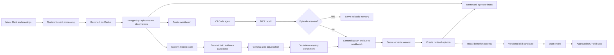

# Synapse

Synapse is a working fast-and-slow memory POC. System 1 replays mocked Slack and meeting
events, interprets each event with a local model, persists the original episode and its
provisional observation, and indexes the episode in Mem0. A user-triggered System 2 sleep
cycle freezes the source episodes and consolidates them into an evidence-backed semantic
graph. System 1 source information comes only from the deterministic mock Slack and meeting
adapters.

## Current Flow



System 1 currently produces:

- A Gemma-classified intent label
- Gemma-classified salience from 0 to 1
- An event-local compact summary assembled without cross-event inference
- Explicit entity mentions supplied by validated source assertions
- Source and intent retrieval tags
- Provider and latency metadata

These observations remain provisional. Only System 2 writes canonical entities, aliases,
relationships, and evidence to the semantic graph.

## Implemented Components

### Backend

- FastAPI application with health, configuration, episode-listing, and mock-replay routes
- SQLAlchemy models for source/retrieval episodes, intent observations, and recall events
- Alembic migration that creates the PostgreSQL schema and enables pgvector
- Duplicate-safe ingestion using stable source identifiers
- Pending-memory reconciliation when an episode exists but has not been indexed
- Persisted System 2 runs with frozen episode membership, stages, status, and graph diffs
- Generic consolidation of validated source assertions into canonical entities and relationships
- Source-owned aliases, descriptions, attributes, and relationship evidence
- Gemma adjudication of evidence-backed alias candidates with deterministic fallback
- Crustdata domain identification and selected company-profile enrichment
- Provider-specific 24-hour enrichment cache
- Idempotent graph upserts and relationship-to-episode evidence links
- Episodic-first recall with Gemma answerability selection
- Evidence-backed semantic fallback and explicit total misses
- Retrieval-episode write-back into Mem0 for future paraphrased queries
- Recall-event telemetry recording origin, selected IDs, scores, and latency
- Recall-query classification into stable workflow families
- Repeated-workflow detection with an explicit minimum occurrence threshold
- Declarative skill synthesis with immutable revisions and review status
- Worker container with database connectivity for background-process scaffolding

### MCP

- Stable MCP Python SDK v1 server over stdio
- Typed `recall` tool using the mandatory episodic-first learning loop
- Typed `get_episode` tool for citation inspection
- Typed `list_skill_specs` and `get_skill_spec` tools exposing approved workflows only
- Docker Compose launch through `.vscode/mcp.json`
- Workspace instructions requiring coding agents to use `recall` for organizational context

### Local Inference

- Cactus 2.0.1 running natively on macOS with Apple Metal
- `google/gemma-4-E2B-it` for compact System 1 intent and salience classification
- Event-local assembly for summaries, explicit mentions, and tags to avoid brittle long JSON
- The same Gemma server for 1,536-dimensional embeddings
- OpenAI-compatible chat, model, and embedding endpoints on port `8080`
- Fail-closed `auto` mode: invalid or unavailable Cactus does not store a fallback observation
- Explicit deterministic interpretation only with `INFERENCE_MODE=fake`

### Memory and Storage

- PostgreSQL 18 with pgvector 0.8.5 in Docker
- Mem0 OSS embedded in the FastAPI process
- Mem0 collection `synapse_episodes_gemma_1536`
- Exact Mem0 writes with `infer=False`; Synapse controls the stored summaries
- Mem0 hybrid semantic, keyword, and entity-aware retrieval support
- In-memory Mem0 operation history; durable application state remains in PostgreSQL
- Persistent PostgreSQL Docker volume
- External semantic attributes with provider, field group, confidence, source URL, and time

### Workbench

- Responsive React 19 and TypeScript interface served by nginx
- Awake/System 1 episode timeline
- PostgreSQL and Cactus status indicators
- Mock replay and refresh controls
- Mem0 indexed/pending state per episode
- Sleep-cycle control and persisted latest-run summary
- Semantic entity browser with aliases, descriptions, kinds, and confidence
- Relationship browser with source/target entities and episode evidence
- External enrichment provider shown on enriched entities
- Procedural pattern detection over real recall history
- Skill workflow, trigger, guardrail, confidence, and evidence inspection
- Candidate approval and rejection controls

## Mock Dataset

The deterministic fixture contains 18 chronological Slack and meeting episodes covering:

- Officially sourced product context for Channel3, Allus AI, Random Labs, and Hexclave
- Internal evaluation decisions that adopt, defer, or limit each possible integration
- The boundary between Synapse memory guidance and Random Labs repository execution
- Hexclave as a future identity candidate for a multi-user Synapse
- A non-critical Channel3 API-access blocker and the decision not to fake an integration
- Repeated status requests with explicit owners, deadlines, blockers, and next actions
- Recall rehearsal and final demo-readiness approval

Public product claims include an official source URL in event metadata. Internal fit,
ownership, blocker, and scope statements are clearly framed as mock team decisions. The
source adapter also supplies generic validated semantic assertions; extraction code has no
knowledge of sponsor names. Crustdata is called only from System 2 after a `Company` entity
and domain have been resolved. It is an enrichment provider, not a source-memory company.

Replaying the fixture multiple times does not duplicate episodes. With Cactus running, all
18 episodes are indexed in Mem0/pgvector. A sleep cycle currently produces 21 canonical
entities and 20 relationships. Repeating the sleep cycle updates the existing graph without
duplicating it. With `CRUSTDATA_API_KEY` configured, Crustdata attempts live enrichment for
the four sponsor company nodes; provider coverage is preserved as an observed result rather
than filled with invented data.

## Run Locally

Prerequisites:

- macOS on Apple Silicon
- Docker Desktop
- Cactus installed with `brew install cactus-compute/cactus/cactus`

Create the local environment file:

```sh
cp .env.example .env
```

Start native Gemma in a separate terminal and leave it running:

```sh
make cactus
```

Start the Docker stack and replay the fixture:

```sh
make up
make replay
```

Open the Sleep view and select **Start sleep cycle**, or trigger it directly:

```sh
curl --fail --request POST http://localhost:3000/api/system2/consolidate
```

Ask Synapse through HTTP:

```sh
curl --fail http://localhost:3000/api/recall \
	--header 'Content-Type: application/json' \
	--data '{"query":"What does Random Labs build and how does it complement Synapse?"}'
```

### Use MCP in VS Code

VS Code discovers the `synapse-memory` server from `.vscode/mcp.json`. The configuration
launches the current server image with:

```sh
docker compose run --rm -T --build mcp
```

Keep native Cactus and the Docker stack running, then:

1. Open the Command Palette with `Cmd+Shift+P`.
2. Run **MCP: List Servers**.
3. Select `synapse-memory` and start or restart it.
4. Open Copilot Chat in Agent mode.
5. Enable the Synapse tools in the tools picker if they are not already enabled.

Available tools:

- `recall(query)` runs the episodic-first learning loop and returns structured citations.
- `get_episode(episode_id)` inspects one durable episode cited by a recall result.
- `list_skill_specs()` lists approved procedural workflows.
- `get_skill_spec(name)` returns one approved workflow with steps and guardrails.

Example agent prompts:

```text
Use the synapse-memory recall tool to compare the team decisions about Random Labs,
Hexclave, Channel3, and Allus AI. Include the evidence citations.
```

```text
Ask Synapse why the Channel3 integration was limited to public product context.
```

For an answer already present in an episode, `answer_origin` is `episodic`. When episodes
do not contain the answer, it is `semantic_fallback` and `created_episode_id` identifies the
new retrieval episode. A similar later request should return `episodic` with
`memory_kind: retrieval` in `score_details`.

After changing MCP code, use **MCP: List Servers → synapse-memory → Restart Server**. If
the server is not listed, run **Developer: Reload Window**. Running the Compose MCP command
manually will appear idle because the process is waiting for protocol messages on stdin.

### Build Procedural Memory

Repeat a recall workflow at least twice, then use the Procedural view's **Detect patterns**
button or call:

```sh
curl --fail --request POST http://localhost:3000/api/procedural/detect
```

Review the generated skill in the Procedural view. Candidate and rejected skills remain
private to the workbench; approving a skill makes it visible to `list_skill_specs` and
`get_skill_spec` after the MCP server is restarted.

Open:

- Workbench: http://localhost:3000
- FastAPI: http://localhost:8000
- OpenAPI: http://localhost:8000/docs

The Docker containers access native Cactus through `host.docker.internal`. If Cactus is not
running, health reports degraded and `INFERENCE_MODE=auto` refuses to store a fallback
System 1 observation. Use `INFERENCE_MODE=fake` only when deterministic interpretation is
explicitly desired.

## API

| Method | Path | Purpose |
| --- | --- | --- |
| `GET` | `/api/health` | PostgreSQL and Cactus availability plus active models |
| `GET` | `/api/config` | Public model, embedding dimension, and retrieval threshold |
| `GET` | `/api/episodes` | Latest persisted episodes and Mem0 indexing state |
| `POST` | `/api/demo/replay` | Idempotently process and reconcile the mock event stream |
| `POST` | `/api/recall` | Search episodes first, fall back to graph, and learn from fallback |
| `POST` | `/api/procedural/detect` | Detect repeated recall workflows and synthesize skills |
| `GET` | `/api/procedural/patterns` | List observed workflow patterns and evidence IDs |
| `GET` | `/api/procedural/skills` | List skill candidates, versions, and review states |
| `POST` | `/api/procedural/skills/{id}/status` | Approve, reject, or reset a skill candidate |
| `POST` | `/api/system2/consolidate` | Run a persisted sleep cycle over a frozen episode snapshot |
| `GET` | `/api/system2/runs` | List recent consolidation runs and graph diffs |
| `GET` | `/api/system2/graph` | Return canonical entities, aliases, relationships, and evidence |

## Docker Services

| Service | Current responsibility |
| --- | --- |
| `db` | PostgreSQL 18 and pgvector |
| `migrate` | One-shot Alembic schema upgrade |
| `api` | FastAPI, System 1, Cactus client, and Mem0 |
| `worker` | Background worker process and database heartbeat |
| `web` | nginx-hosted React build and `/api` proxy |
| `mcp` | On-demand stdio MCP server for VS Code |
| `test` | Container profile for pytest |

## Commands

```sh
make up       # Build and start the Docker stack
make cactus   # Start native Gemma on Cactus/Metal
make replay   # Process or reconcile the mock event stream
make logs     # Follow API, worker, and web logs
make lint     # Run Python and frontend static checks
make test     # Run backend tests and frontend validation
make down     # Stop containers while preserving PostgreSQL data
make reset    # Stop containers and delete the PostgreSQL volume
```

## Validation Status

The current implementation passes:

- Ruff
- Strict mypy
- Pytest
- ESLint
- TypeScript compilation
- Vite production build
- Alembic migration against PostgreSQL 18
- Docker Compose health checks
- Duplicate replay and pending-memory reconciliation
- Native Gemma chat and embedding smoke tests
- System 2 migration, extraction, alias, evidence, and API schema tests
- Gemma alias-adjudication and fallback tests
- Crustdata no-key behavior and live-response parser tests
- Live consolidation and graph idempotency checks
- Live Crustdata enrichment and cache verification
- Episodic miss → semantic fallback → retrieval-episode write-back
- Paraphrased episodic hit with preserved original citations
- MCP initialize, tool discovery, and structured `recall` invocation over stdio
- Idempotent pattern detection and immutable skill revision checks
- Candidate approval synchronization between patterns and skills
- Approved-only procedural skill discovery through MCP

## Current Boundaries

System 2 deterministically merges validated semantic assertions emitted by source adapters,
then uses Gemma to adjudicate ambiguous aliases. Assertions use generic entity and
relationship schemas; runtime extraction and inference contain no fixture-specific names.
The installed E2B model is not used to generate the complete nested graph because its long
structured output is unreliable. The current procedural templates cover company research,
architecture context, and project status briefing families. Pattern classification and
synthesis are deterministic and transparent rather than LLM-generated. Synapse exposes
approved guidance only; coding actions remain with the VS Code agent.